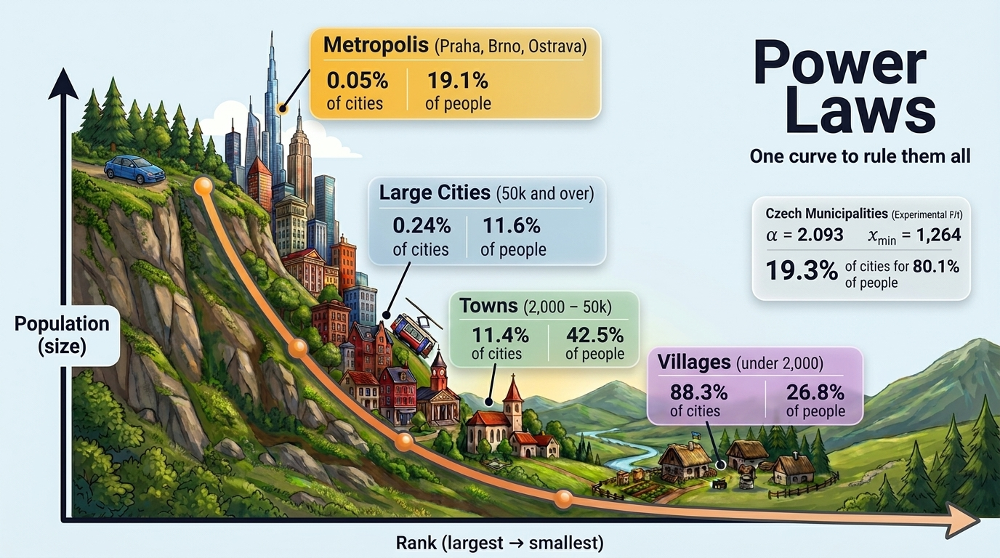

# Power Laws

Experiments summarising how power-law distributions behave: the theory, simulations and a real-world example.



I put this together to teach myself about power laws, whose unusual properties I find intriguing, and then shared what I learned in a talk to my colleagues. `00_presentation.html` is the teaser presentation from that talk.

## Contents

- `00_presentation.html`: teaser slides on fat tails, why power laws break the bell curve, and where they show up.
- `01_theory.ipynb`: the core maths from first principles: normalisation, CDF, the 80/20 rule, and why a power law is a straight line on a log-log plot.
- `02_playground.ipynb`: experiments with synthetic data: varying α, sampling, estimating α, and moments that refuse to converge.
- `03_real_world.ipynb`: do Czech municipal populations follow a power law or a bell curve? The tail is a clear power law (α ≈ 2.09): 19 % of municipalities hold 80 % of the population.
- `utils/graph.py`: plotting helpers.

## How to run

```bash
uv sync
```

To replicate the real-world experiment, download [Počet obyvatel v obcích k 1. 1. 2025](https://csu.gov.cz/produkty/pocet-obyvatel-v-obcich-rlm0s92pwn) and save it as `data/pocet_obyvatel_obce_2025.xlsx`.

## Credits

- Data: [Czech Statistical Office (ČSÚ)](https://csu.gov.cz/). Thanks for the open data.
- Literature: M. E. J. Newman, "Power laws, Pareto distributions and Zipf's law", *Contemporary Physics* 46(5), 323–351 (2005), [arXiv:cond-mat/0412004](https://arxiv.org/abs/cond-mat/0412004). Well worth reading if you are interested in the topic.
